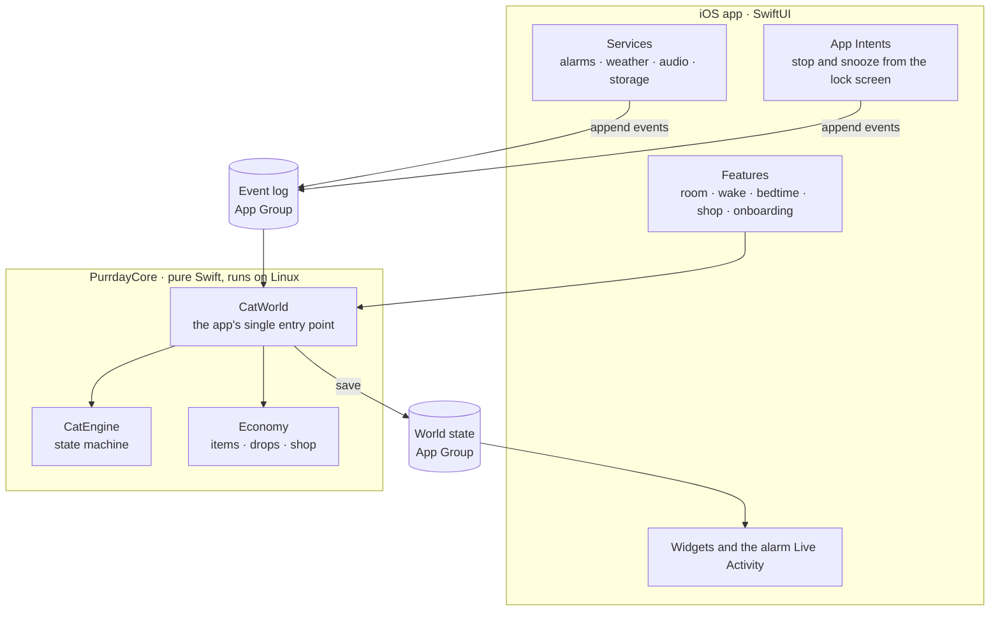
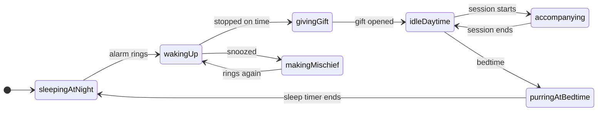

<h1 align="center">Purrday</h1>

<p align="center">
  <strong>A cat that lives on your phone and keeps you company through the day.</strong><br />
  She wakes you up, rewards you for getting up on time, and purrs you to sleep.
  A native iOS app in SwiftUI and Swift 6, built on a deterministic pure-Swift core.
</p>

<p align="center">
  <a href="https://github.com/lokihiyori/purrday-showcase/actions/workflows/ci.yml"></a>
  
  
  
  
</p>

> **This is a public snapshot.** Purrday is in active development in a private repository. This
> repository holds a snapshot of its source code for review. Artwork, audio, fonts and the string
> catalog are not included, so the app target does not build from here; the core package builds and
> passes its tests on its own, and CI runs them on every push.

## What it does

- **Wakes you up, even on Silent.** Alarms are scheduled with AlarmKit, so they ring through Silent
  mode and Focus. Stop one by petting the cat, or snooze and stop from the lock screen.
- **Makes getting up worth it.** Get up on time and the cat brings a breakfast gift and some dried fish,
  the in-app currency. Snooze, and she gets up to mischief you tidy up later. Mischief is playful by
  design: it never costs you anything, and the cat never gets sick or leaves.
- **Grows to trust you.** A hidden bond takes her from shy to affectionate, and each breed has its own
  temperament that changes how she reacts to the same interaction.
- **Purrs you to sleep.** Bedtime mode plays her purring with a sleep timer.
- **Lives in your weather.** With approximate location (opt-in), the view from her window follows your
  real weather, seasons, sunrise and sunset through WeatherKit.
- **Stays on the lock screen.** Widgets and an alarm Live Activity share state with the app.
- **Speaks four languages.** English, Simplified Chinese, Traditional Chinese and Japanese.

Focus, reading and movement sessions, where the cat keeps you company while you work, are modelled
in the core and planned for the app.

## Engineering highlights

- **A deterministic core.** The cat is a pure-Swift state machine with seven states and 22 transitions.
  It imports no SwiftUI, UIKit or system clock: every event carries its own timestamp, and the time zone,
  calendar and randomness are injected. The same event log always produces the same day, so the app can
  replay what it missed after a cold start. Every transition has its own named unit test.
- **An idempotent event log.** App Intents, AlarmKit callbacks and in-app actions append events to a log
  in the shared App Group container. `CatWorld.ingest` skips event ids it has already applied, so the log
  can be resubmitted in full without ever granting a reward twice.
- **A data-driven economy.** Items, prices and weighted drop tables live in JSON, tests check that the
  catalogue is self-consistent, and a seeded generator saved with the game state makes every drop
  reproducible.
- **Deep platform integration.** AlarmKit, App Intents, WidgetKit, ActivityKit, WeatherKit with
  reduced-accuracy location, AVFoundation for bedtime audio, and StoreKit.
- **Swift 6 strict concurrency** across the app and its widget extension.
- **350+ tests** in Swift Testing for the core and the app layer, plus an XCUITest walkthrough that taps
  through the whole app from onboarding and screenshots every screen in each language.
- **A generated project.** The Xcode project is generated from [`project.yml`](project.yml) with
  XcodeGen, so no `.xcodeproj` is checked in.

## Architecture



The app never talks to the state machine directly. Screens and services go through `CatWorld`, which
turns events into a new state plus three kinds of output: effects to perform (play the purr, add a
mess), rewards to show, and prompts to handle. Details are in [docs/ARCHITECTURE.md](docs/ARCHITECTURE.md).

## The cat's day



These are the nine transitions of the original design. Thirteen more cover what real days do: stopping
after a snooze, alarms during the day, going to bed without bedtime mode, and more.

## Project structure

```
Core/        PurrdayCore Swift package: CatEngine, Economy and CatWorld, with their tests
App/         app entry point, services (alarms, weather, audio), persistence and App Intents
Features/    SwiftUI screens: room, wake-up, bedtime, alarms, shop, onboarding, paywall
Widgets/     lock-screen widgets and the alarm Live Activity
AppTests/    app-layer tests (Swift Testing)
UITests/     a walkthrough that taps through the app and screenshots each screen
scripts/     ui_walkthrough.sh runs that walkthrough in the simulator for each language
project.yml  XcodeGen project definition
Resources/   not included in this snapshot (artwork, audio, fonts, strings)
```

## Build and test

The core package needs Swift 6.2 or later, on macOS or Linux:

```bash
swift test --package-path Core
```

The app needs macOS with Xcode 26, XcodeGen, and the `Resources/` folder from the private repository:

```bash
brew install xcodegen
xcodegen generate
xcodebuild test -scheme Purrday -destination 'platform=iOS Simulator,name=iPhone 17'
```

## Status

Purrday is in active development and not yet released. This snapshot was taken on November 16, 2026.

Code comments are written in Chinese, the author's working language; identifiers, APIs and this
documentation are in English. Some comments refer to design documents that stay in the private
repository.

## License

Copyright © 2026 Kaisheng Liu. All rights reserved.

This snapshot is published for portfolio review. No license is granted to copy, modify or distribute
the code or use it outside the rights provided by GitHub's Terms of Service.
