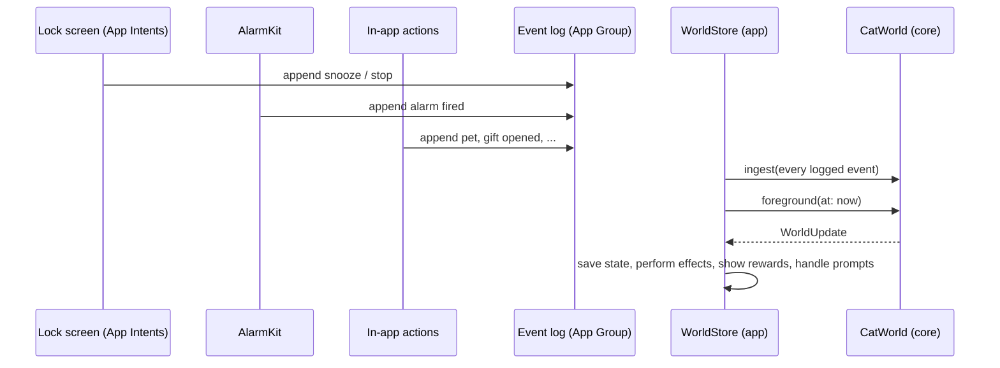

# Purrday architecture

Purrday is split into a pure-Swift core that decides everything, and an iOS layer that turns those
decisions into pictures, sounds, alarms and widgets.

| Module | Kind | Responsibility |
| --- | --- | --- |
| `CatEngine` | Swift package target | The cat's state machine: events in, a new state, reward types and side effects out |
| `Economy` | Swift package target | Dried fish (the currency), the item catalogue, drop tables, the shop, selling gifts |
| `CatWorld` | Swift package target | The single entry point: ties the engine and economy to alarm schedules, daily records, the bond, and prompt timing |
| `App` | iOS app | Entry point, services (alarms, weather, audio), persistence, App Intents |
| `Features` | iOS app | SwiftUI screens: room, wake-up, bedtime, alarms, shop, onboarding, paywall |
| `Widgets` | Widget extension | Lock-screen widgets and the alarm Live Activity |

## The core is pure

`CatEngine`, `Economy` and `CatWorld` may not import SwiftUI, UIKit or SwiftData, and they must build
and test on Linux. CI enforces that by running the core's tests in a Linux container on every push.

The core never reads the system clock. Every event carries its own timestamp, the time zone and calendar
are passed in, and random drops come from a seeded generator whose seed is saved with the game state.
Given the same event log, the core always produces the same day. That is what makes three things
possible:

- **Replay.** After a cold start the app hands the core every event it missed, and the result is the
  same as if they had been processed live.
- **Time catch-up.** Before handling an event, the engine first runs any time-based transitions that fell
  due before it (bedtime, the sleep cutoff, the morning cut-over, and two timeouts), in order.
- **Testability.** Each transition is tested with fixed timestamps, without waiting for real time to pass.

## Events in, updates out

- Whoever writes an event gives it an id. `CatWorld.ingest` skips ids it has already applied, so the whole
  log can be resubmitted at any time without granting a reward twice.
- A `WorldUpdate` carries the new state and three lists: **effects** for the app to perform (start the
  purr, add a mess to the room), **grants** to show ("she brought a star candy, +10 fish"), and
  **prompts** to handle (the paywall, a rating request).
- `WorldStore` is the only object in the app that holds a `CatWorld`. Screens read and change state
  through it.

## The state machine

| State | What the cat is doing |
| --- | --- |
| `sleepingAtNight` | Curled up at the foot of the bed until the next alarm |
| `wakingUp` | The alarm is ringing: she stretches, then meows until you stop it |
| `givingGift` | You got up on time, so she brings a breakfast gift |
| `makingMischief` | You snoozed. Each snooze escalates: stepping on your face, pushing a cup off the table, lying on your phone |
| `idleDaytime` | Her default day: wandering, grooming, watching the window, using her furniture |
| `accompanying(activity)` | Keeping you company during focus, reading or movement (modelled in the core; app UI planned) |
| `purringAtBedtime` | Purring at the foot of the bed while you fall asleep |

The original design has nine transitions:

| # | From | Trigger | To |
| --- | --- | --- | --- |
| T1 | sleepingAtNight | the alarm rings | wakingUp |
| T2 | wakingUp | stopped on time (no snooze, within two minutes of the first ring) | givingGift, with a reward |
| T3 | givingGift | the gift is opened or dismissed | idleDaytime |
| T4 | wakingUp | snoozed | makingMischief, adding a mess to the room |
| T5 | makingMischief | the snoozed alarm rings again | wakingUp |
| T6 | idleDaytime | a session starts | accompanying |
| T7 | accompanying | the session is completed | idleDaytime, with a reward |
| T8 | idleDaytime | bedtime arrives | purringAtBedtime |
| T9 | purringAtBedtime | the sleep timer ends | sleepingAtNight |

Thirteen more transitions (X1 to X13) cover what real days do and the diagram left out, such as stopping
the alarm after a snooze, an alarm that rings during the day, or going to bed without bedtime mode. Every
transition, T and X, has at least one unit test named after its id.

One rule holds everywhere: the cat never gets sick, leaves or dies. Mischief is meant to be cute and can
be tidied up, and it never takes away fish or items.

## Economy

`CatEngine` only says which kind of reward was earned; `Economy` decides what is granted.

- **Rewards.** Getting up on time earns fish and a breakfast gift, finishing a focus session or a book
  earns fish, and reaching a step goal earns an outdoor souvenir.
- **Items.** Breakfast gifts can be sold or kept, souvenirs are collectibles, furniture is bought with
  fish and changes what the cat can do in her room, and coats change her look.
- **Drops.** Gifts are drawn from weighted tables in four rarities, from common to legendary, with a luck
  boost that raises the odds of rare items.
- **Data, not code.** The catalogue and drop tables live in `Core/Sources/Economy/Resources/catalog.json`.
  Tests load it and check that it is self-consistent, so tuning the economy means editing JSON.

## The app layer

- **Alarms.** AlarmKit schedules the alarms, so they ring through Silent mode and Focus. App Intents let
  you snooze or stop from the lock screen, and an ActivityKit Live Activity shows the ringing alarm.
- **Storage.** The world state and the event log live in the App Group container, so the widget
  extension reads the same state as the app.
- **Weather and daylight.** When the user opts in, `RealSky` asks for reduced-accuracy location and uses
  WeatherKit so the view outside her window matches real weather, seasons, sunrise and sunset.
- **Sound.** Purring, her voice and bedtime ambience run on AVFoundation, with background audio for
  bedtime mode.
- **Drawing the cat.** Her artwork is animated procedurally in SwiftUI: a small rig makes the image breathe,
  sway and walk step by step, and each breed moves in its own style.
- **Purchases.** A Plus tier is designed into the economy (double fish rewards, extra coats). The
  purchase integration is still in progress.

## Concurrency

The project uses the Swift 6 language mode, with complete strict concurrency checking for the app and the
widget extension. The core's public types are value types and enums that conform to `Sendable`.

## Testing

| Suite | Framework | Covers |
| --- | --- | --- |
| `Core/Tests` | Swift Testing | every state-machine transition, the economy and its catalogue, world replay and idempotent ingest |
| `AppTests` | Swift Testing | the app layer, such as interactions in the room and their effect on the bond |
| `UITests` | XCUITest | a walkthrough from onboarding through every screen, with a screenshot of each, per language |

`scripts/ui_walkthrough.sh` runs the walkthrough in the simulator for any of the four languages.
